# EasySewa — On-Demand Home Services Booking App

  <em>A mobile UI/UX design concept for discovering, selecting, and booking home and personal care services at your doorstep.</em>

  
  
  
  
  

---

## 📖 About the Project

**EasySewa** is a mobile application UI/UX design project for an on-demand home services platform inspired by service marketplaces such as Urban Company. The concept enables users to explore home and personal care services, review pricing, discover nearby providers, and access booking information through a structured mobile interface.

The design was created in **Figma**, focusing on usability, visual consistency, clear navigation, and a streamlined service discovery experience.

The project explores key UI/UX concepts such as reusable interface components, visual hierarchy, typography, spacing systems, color themes, gradients, and multi-screen user flows.

---

## ✨ Key Features

| Feature | Description |
|---|---|
| 🔐 **Authentication UI** | Mobile number entry and OTP verification screen designs |
| 🏠 **Service Discovery** | Categorized home and personal care service listings |
| 💇 **Service Selection** | Service options, descriptions, and price presentation |
| 🛒 **Cart Interface** | Selected-service review and cart interaction design |
| 💳 **Payment Summary UI** | Layout for reviewing booking and payment details |
| 📍 **Location-Based UI** | Map-based provider discovery and address selection screens |
| 📅 **Booking Management UI** | Upcoming appointments and booking history layouts |
| 👤 **Provider Interface** | Screen design for viewing provider-booked services |
| 🎨 **Visual Design System** | Consistent typography, colors, spacing, icons, and interface elements |

*These are interface designs and interaction concepts, not claims of a fully functional backend or payment system.*

---

## 🛠️ Tools & Technical Design Concepts

| Tool / Concept | Purpose |
|---|---|
| **Figma** | Mobile screen design, interface organization, and design collaboration |
| **Reusable Components** | Consistency across buttons, service cards, icons, and navigation elements |
| **Auto Layout** | Structuring spacing and alignment when used in the design |
| **Constraints & Resizing** | Managing element behavior when frames or screen dimensions change |
| **Figma Plugins** | Potential support for icons, illustrations, mockups, and design workflows |
| **Color Styles** | Maintaining consistent colors and theme values |
| **Typography System** | Consistent font hierarchy, sizing, and readability |
| **Gradients & Effects** | Visual emphasis, depth, and decorative interface styling |
| **Prototyping** | Connecting screens to represent intended navigation and interactions |
| **Responsive Layout Principles** | Considering different screen sizes and adaptable interface layouts |

> **Note:** Auto Layout, plugins, prototyping, and responsive behavior should be listed as implemented skills only where you actually used them in this project.

---

## 🎨 Color Theme & Visual Language

EasySewa uses a clean, service-oriented visual style with green accents, light backgrounds, and clearly separated content cards.

| Design Element | Purpose |
|---|---|
| **Green Accent Theme** | Highlights primary actions and reinforces brand consistency |
| **Light Backgrounds** | Keeps service information readable and the interface uncluttered |
| **Neutral Surfaces** | Separates cards, forms, and content sections |
| **Typography Hierarchy** | Distinguishes screen titles, service names, descriptions, and prices |
| **Gradients & Visual Effects** | Can provide emphasis and depth where applied in the actual design |
| **Consistent Spacing** | Improves alignment and readability across screens |
| **Icons & Illustrations** | Help users recognize service categories and actions |

The intended visual direction prioritizes clarity, comfortable navigation, and easy access to service information.

---

## 🧩 UI Components & Design Elements

The interface uses recurring design patterns to create consistency across the application.

- **Service Cards:** Image, service name, supporting description, and navigation action.
- **Pricing Elements:** Clearly visible service names and associated prices.
- **Navigation Elements:** Back controls and bottom navigation for moving between app sections.
- **Input Components:** Mobile number entry and verification-code fields.
- **Action Buttons:** Primary actions for proceeding through service-related flows.
- **Booking Cards:** Appointment details, provider information, and booking actions.
- **Location Elements:** Map-based provider markers and address-selection layouts.
- **Status Indicators:** Ratings, booking states, and supporting information.

Reusable components can simplify future design updates and improve consistency when the same elements appear across multiple screens.

---

## 📱 Application Screenshots

The following images use the filenames present in the repository's `screenshots/` folder.

### 1. Authentication

**Login Screen**

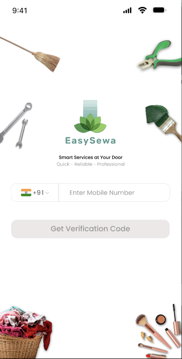

**OTP Verification**

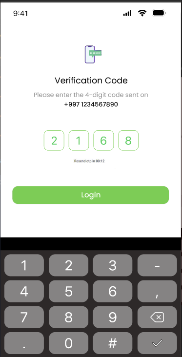

### 2. Service Discovery & Selection

**Beauty Services**

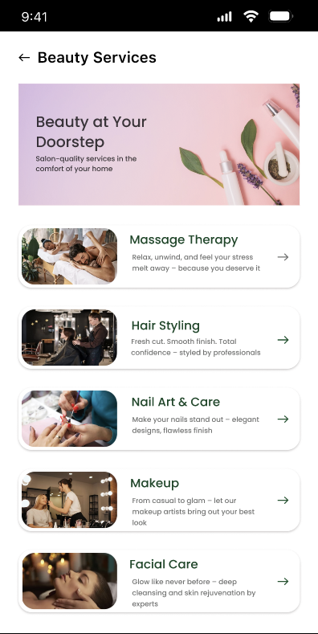

**Hair Styling**

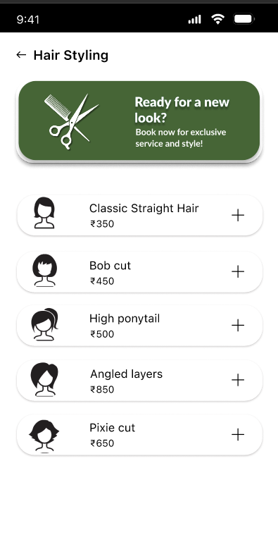

### 3. Cart & Payment Flow

**Cart**

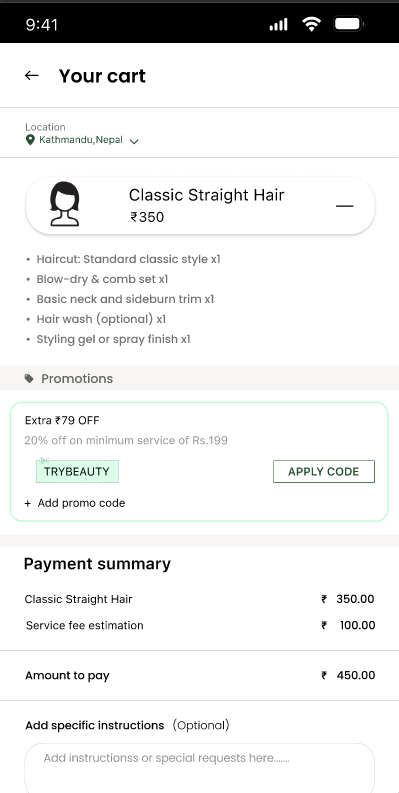

**Cart Payment Summary**

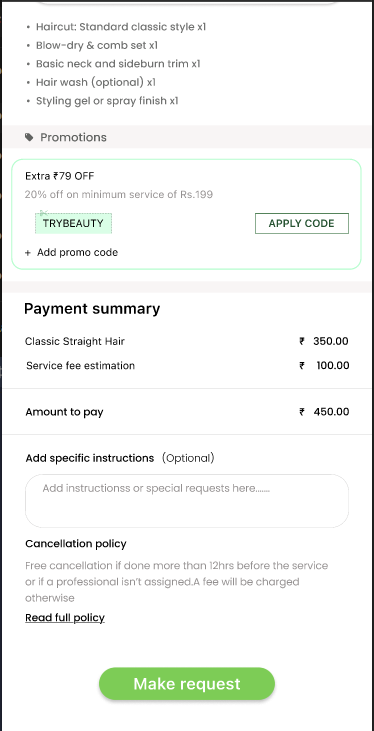

### 4. Address & Provider Discovery

**Select Address**

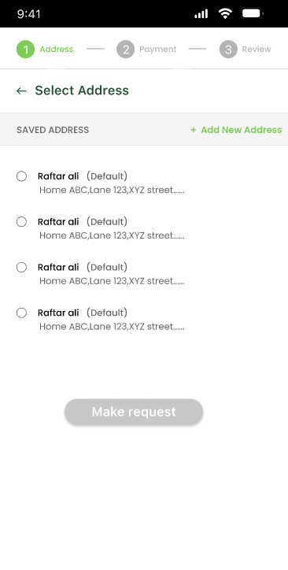

**Address Selected**

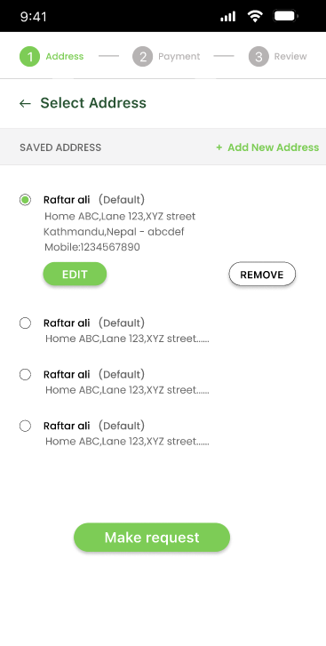

**Disclaimer**

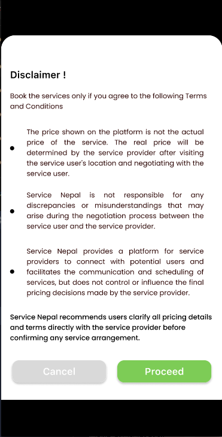

**Nearby Providers Map**

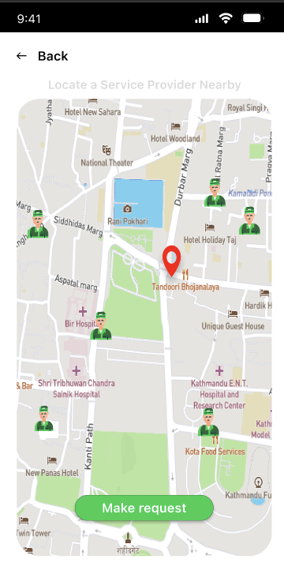

### 5. Booking Management

**User Booking History**

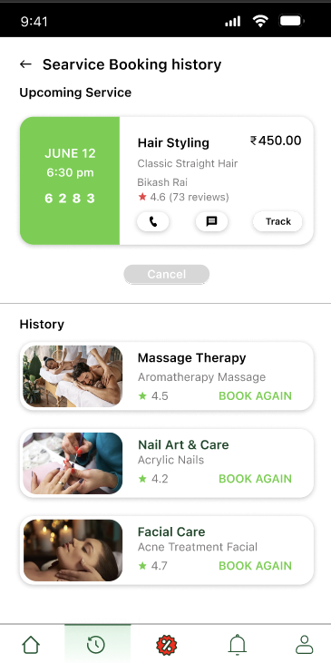

**Provider Booked Services**

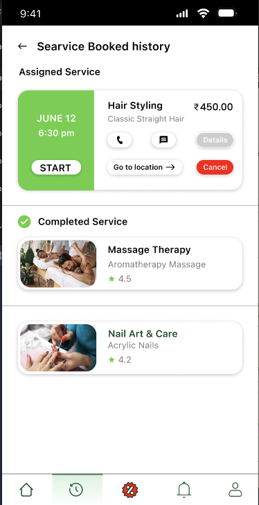

---

## 🔄 User Flow

The proposed service journey is organized into the following stages:

1. **Authentication:** Enter a mobile number and proceed through the OTP verification interface.
2. **Service Discovery:** Browse available home and personal care categories.
3. **Service Selection:** Review service options and prices.
4. **Cart Review:** View selected services and the payment summary interface.
5. **Address Selection:** Choose the location where the service is requested.
6. **Provider Discovery:** Explore the location-based provider interface.
7. **Booking Review:** View upcoming appointments and booking history.

This flow documents the intended user experience represented by the designed screens.

---

## 🏗️ Design Structure

The design can be understood through three conceptual layers:

| Layer | Responsibility |
|---|---|
| **Presentation Layer** | Screen layouts, cards, buttons, icons, typography, and color styling |
| **Navigation Layer** | Connections between authentication, services, cart, address, and booking screens |
| **Interaction Layer** | Intended actions such as selecting a service, proceeding through booking, and reviewing appointments |

These layers describe the design organization rather than implemented software architecture.

---

## 📐 Responsive Design Considerations

Although the supplied screens are mobile-oriented, the following principles can guide further design refinement:

- Use Auto Layout to maintain consistent spacing within supported components.
- Apply frame constraints and resizing rules to manage element positioning.
- Adapt service cards and content layouts for different mobile screen dimensions.
- Maintain readable typography and appropriately sized touch targets.
- Prevent text, images, and action buttons from overlapping on smaller screens.
- Test layouts across multiple frame sizes before considering the interface responsive.

Responsive behavior should be validated in Figma across different screen dimensions; a mobile design alone does not prove that every layout is responsive.

---

## 🚀 Future Improvements

- Refine reusable components and establish a documented design system.
- Extend the design to additional mobile screen sizes.
- Develop an interactive Figma prototype for the complete booking journey.
- Conduct usability testing and incorporate user feedback.
- Design provider availability and booking-status flows.
- Develop functional mobile screens connected to backend APIs.
- Integrate real map services, authentication, and payment processing during application development.
- Improve accessibility, contrast, and touch-target sizing.

---

## ⚠️ Project Scope & Limitations

- EasySewa is documented as a UI/UX design project.
- Authentication and OTP screens represent proposed interface flows.
- Location-based provider discovery is a designed interface, not proof of live GPS integration.
- Cart and payment-summary screens do not imply a functioning payment gateway.
- Backend APIs, databases, authentication logic, and booking processing are not established by the screenshots alone.
- Plugin usage, responsive behavior, and interactive prototyping should be documented according to what was actually implemented.

---

## 🎓 Learning Outcomes

- Mobile application UI/UX design using Figma.
- Multi-screen user flow organization.
- Visual hierarchy, typography, and color-theme consistency.
- Reusable interface component design.
- Service selection, cart, address, and booking interface design.
- Responsive layout considerations and usability principles.
- Translating a service-platform concept into a structured mobile interface.

---

## 🏁 Conclusion

**EasySewa** demonstrates the design of an on-demand home services booking experience through a series of mobile interfaces covering authentication, service discovery, selection, cart review, address selection, provider discovery, and booking history.

The project highlights practical UI/UX design concepts and provides a foundation for future prototyping, usability testing, and mobile application development.

---

## 👤 Author

**Shivam Borane**  
Electronics & Telecommunication Engineering

**Design Focus:** Figma · UI/UX Design · Mobile App Design · User Flows · Interface Components

---

## 📄 License

Confirm permission to publish the client project and its design assets before adding a license or making the repository public.

---

  <em>EasySewa — Designed for a simpler home services experience.</em>

